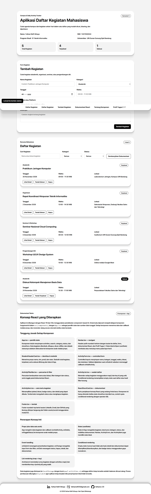

# Aplikasi Daftar Kegiatan Mahasiswa

Campus & Daily Activity Tracker untuk mencatat kegiatan akademik dan keseharian mahasiswa.

**Mahasiswa:** Fathan Rafif Athaya  
**NIM:** 1247050044 — S1 Teknik Informatika, Semester 5  
**Profil:** [fathanra.vercel.app](https://fathanra.vercel.app)

## Demo produksi dan repository

- [Live Demo — Aplikasi Daftar Kegiatan Mahasiswa](https://fathanra-activities.vercel.app)
- [Repository GitHub — F-Campus-Activity-Tracker](https://github.com/fathanra-20/F-Campus-Activity-Tracker)

## Bukti screenshot



## Fitur

- Menambah kegiatan dengan nama, kategori, tanggal, waktu, lokasi, dan deskripsi.
- Mengubah status kegiatan antara `Terjadwal` dan `Selesai`.
- Mencari kegiatan berdasarkan nama atau lokasi.
- Memfilter kegiatan berdasarkan kategori dan status.
- Menampilkan atau menyembunyikan detail setiap kegiatan.
- Menghapus kegiatan dan menyimpan daftar secara persisten di `localStorage`.
- Menampilkan statistik total, terjadwal, dan selesai, serta dokumentasi konsep React.

## Arsitektur React

Antarmuka dibangun sebagai komponen terpisah di `src/components/`:

- `Navbar.tsx` — navigasi bagian halaman, dokumentasi, dan profil.
- `StudentHeaderCard.tsx` — identitas mahasiswa dan ringkasan statistik.
- `ActivityForm.tsx` — formulir terkontrol dan validasi kegiatan.
- `ActivityFilterBar.tsx` — pencarian, filter, dan kontrol panel dokumentasi.
- `ActivityList.tsx` dan `ActivityItem.tsx` — daftar kegiatan, status, detail, dan aksi hapus.
- `ReactDocsCard.tsx` — dokumentasi konsep yang diterapkan.
- `Footer.tsx` — tautan kontak dan informasi hak cipta.

Konsep yang diterapkan:

- **Props:** data kegiatan, pilihan filter, dan handler dikirim dari `App.tsx` ke komponen anak.
- **State (`useState`):** menyimpan kegiatan, nilai form, filter, detail terbuka, dan visibilitas dokumentasi.
- **Event handling:** formulir, input, tombol status, hapus, filter, dan menu menggunakan handler React.
- **Conditional rendering:** menampilkan empty state, detail kegiatan, panel dokumentasi, serta badge status.
- **List rendering:** data dan komponen berulang ditampilkan dengan `map()` dan `key` yang unik.

## Struktur folder

```text
tugas-pertemuan-7/
├── public/                 # aset statis
├── src/
│   ├── components/         # komponen React
│   ├── data/               # seed kegiatan awal
│   ├── types/              # model Activity
│   ├── App.tsx             # state dan komposisi aplikasi
│   ├── index.css           # gaya aplikasi
│   └── main.tsx            # entry point React
├── index.html
├── SPEC.md
└── package.json
```

## Menjalankan secara lokal

```sh
npm install
npm run dev
```

Verifikasi kode dan build produksi:

```sh
npm run lint
npm run build
```
